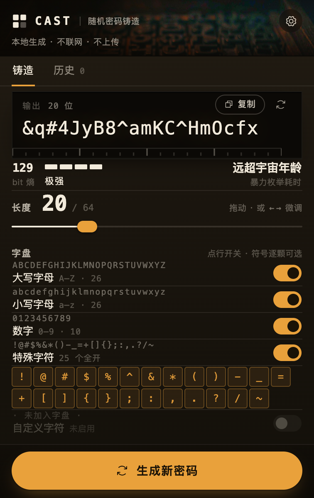

# CAST · 随机密码铸造

一个只做一件事的 Chrome 扩展：点一下，在本机铸一枚随机密码。



[](https://developer.chrome.com/docs/extensions/develop/migrate/what-is-mv3)
[](https://www.google.com/chrome/)
[](./README.md#许可证)

## 为什么做这个

密码管理器生成的密码足够强，但很多时候你只是想临时注册一个站点、填一个验证码、或者换一个一次性口令——打开管理器、解锁、找条目，比用一次密码本身还费劲。CAST 把这个动作压缩成「点开图标 → 点一下 → 粘贴」。

它不联网、不上传、没有账号、没有统计。密码在本机生成，也只留在本机。

## 功能

- **真随机**：随机数来自 `crypto.getRandomValues()`，不用 `Math.random()`；取字符时做拒绝采样，避免取模带来的分布偏移。
- **逐颗挑选特殊字符**：25 个符号每一颗都能单独开关。很多站点会拒绝 `&` `~` `<` `>`，关掉的符号绝不会出现在生成的密码里。整行开关是「整组停用 / 原样恢复」——关掉再打开，你挑过的那些原样回来，不会被重置成全开。
- **长度 6–64**：滑杆拖动，或用 `←` `→` 微调，刻度尺跟着变。
- **自定义字符**：可以追加自己需要的字符集。
- **每组至少一枚**：大写、小写、数字、特殊字符四组各保证出现至少一颗。
- **强度实时可见**：bit 数、强度等级、暴力破解耗时估算，改任何设置立刻重算。
- **复制后 30 秒覆盖剪贴板**：用不可见的零宽字符覆盖，密码不会长期停在系统剪贴板里（Mac 的通用剪贴板尤其需要）。可以在设置里关掉，关掉会撤回还没到点的那次清理。
- **最近 8 枚历史**：按时间排开，点一下复制回来，存在本机 `chrome.storage.local`，不跨设备同步。

## 安装

### 方式 A：直接加载源码（开发用）

1. 打开 `chrome://extensions`
2. 打开右上角「开发者模式」
3. 点「加载已解压的扩展程序」，选择仓库里的 `extension/` 目录

### 方式 B：加载已打包目录

选择 `dist/CAST-extension/` 目录，步骤同上。

> Chrome 137 起移除了 `--load-extension` 命令行开关，稳定版 Chrome 无法通过命令行自动装载扩展，只能手动走这三步。

### 方式 C：商店安装

尚未上架。上架所需的 zip、截图、隐私政策和填写清单都在 [`store/`](store/) 目录里，详见 [`store/上架清单.md`](store/上架清单.md)。

## 目录结构

```
.
├── extension/                  # 扩展源码（无构建步骤，可直接加载）
│   ├── manifest.json           # MV3 清单，version 1.0.0
│   ├── popup.html/css/js       # 378×600 弹窗界面与全部逻辑
│   ├── background.js           # service worker，负责 30 秒闹钟与隐藏页面生命周期
│   ├── offscreen.html/js       # 隐藏文档，执行剪贴板覆盖
│   ├── icons/                  # 16/32/48/128 PNG 图标
│   └── assets/                 # 头部材质图（源码副本）
├── dist/                       # 打包产物
│   ├── CAST-extension/         # 已解压版，可直接加载
│   ├── CAST-1.0.0.zip          # 商店上传用（manifest 在根目录）
│   ├── CAST-1.0.0.crx          # 本地自签测试包
│   ├── keys/                   # ⚠️ 签名私钥，已加入 .gitignore，绝不提交
│   └── 预览-弹窗.png
├── store/                      # 上架物料
│   ├── 上架清单.md              # 可复制的商品文案、权限理由、隐私权实务答案
│   ├── privacy-policy.html     # 自包含隐私政策页，可直接部署
│   └── screenshots/            # 3 张 1280×800 商店截图 + 440×280 小图
```

## 几个实现上的决定

**为什么用 offscreen 文档清空剪贴板？** service worker 没有 DOM，拿不到剪贴板接口；而隐藏的 offscreen 文档永远没有焦点，`navigator.clipboard.writeText()` 在其中会抛 `Document is not focused`。更隐蔽的是，`document.execCommand('copy')` 对空选区返回 `true` 却什么都不做。所以最终方案是在 offscreen 里复制一个零宽字符 `\u200B`——看得见的「清空」做不到，看不见的「覆盖」可以做得到。

**为什么 `picked` 和 `stash` 分成两个集合？** `picked` 是当前生效的字符集合，`stash` 是整行关掉时记住的那一盘。如果只用一个集合，关行再开行就会把用户挑过的 25 颗重置成全开。两者一起持久化，重载后整行仍保持关闭状态，但点开能还原原样。

**为什么弹窗是 378×600？** 设计稿画在 378×844 画布上，但 Chrome 弹窗高度硬上限是 600px。长度设置被提到字盘之前，因为可展开的配置放在主控之后会把「铸密码」按钮挤出屏幕。

**为什么不做远程更新？** 没有服务器、没有远程代码、没有统计。清单里 `permissions` 只有 `storage` `alarms` `offscreen` `clipboardWrite` 四项，每一项都有实际调用点；没有 `host_permissions`，所以扩展读不到任何网页内容。

## 开发

没有构建步骤，改完 `extension/` 里的文件，去 `chrome://extensions` 点一下扩展的刷新图标即可。

重新打包：

```bash
cd dist/CAST-extension && zip -qr ../CAST-1.0.0.zip . -x '.DS_Store'
```

重新生成自签 crx（需要本地私钥）：

```bash
cd dist && "/Applications/Google Chrome.app/Contents/MacOS/Google Chrome" \
  --pack-extension="$PWD/CAST-extension" \
  --pack-extension-key="$PWD/keys/CAST-1.0.0.pem" \
  --no-message-box
```

> `keys/CAST-1.0.0.pem` 是本地打包私钥，**永远不要提交到仓库、不要打进 zip、不要上传到商店**。泄露后别人可以伪造同名扩展的更新。

## 已知限制

- `chrome.alarms` 不跨浏览器重启。如果复制后 30 秒内退出 Chrome，那次剪贴板覆盖会丢失。
- Chrome 稳定版不支持命令行加载扩展，开发调试必须手动装载。
- 密码历史存在本机 `chrome.storage.local`，清理浏览器数据会一并清掉。

## 许可证

项目未指定开源许可证，默认保留所有权利。如需使用、修改或分发，请先联系作者。
